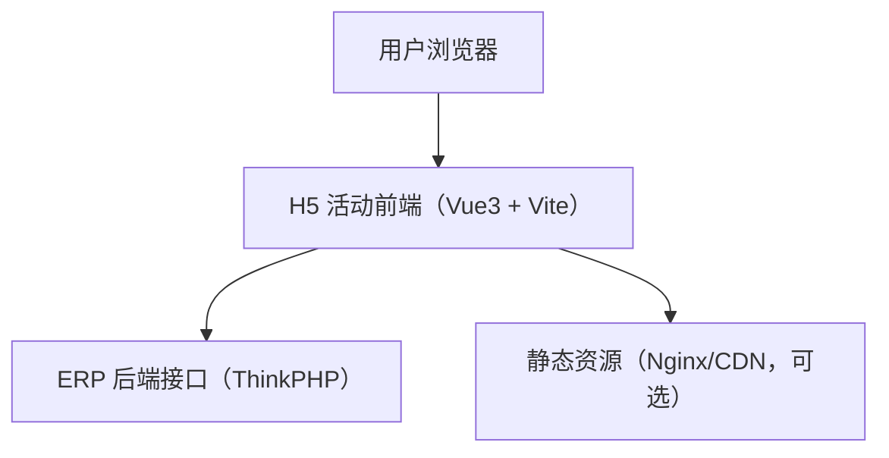

## 1. 架构设计



## 2. 技术说明
- 前端：Vue@3 + Vite + TypeScript
- 路由：Vue Router（活动页面按路由拆分）
- 状态管理：Pinia（用于活动配置、用户参数、全局 UI 状态）
- 请求层：axios（统一拦截器、错误处理、日志开关）
- 样式：CSS 变量 + 组件内样式（活动可独立覆写主题）
- 初始化方式：Vite 模板创建（`npm create vite@latest`）

## 3. 路由定义
| 路由 | 目的 |
|---|---|
| / | 可选：活动入口/灰度页 |
| /campaign/:slug | 活动落地页（根据 slug 渲染对应活动） |
| /404 | 兜底页 |

## 4. API 定义（前端调用约定）

### 4.1 通用返回
```ts
export type ApiResponse<T> = {
  state: "success" | "error";
  info?: T;
  message?: string;
  count?: number;
};
```

### 4.2 活动配置（建议接口形态）
- GET/POST：`/api/h5/campaignConfig`
- 请求：
```ts
export type CampaignConfigRequest = {
  slug: string;
  utm_source?: string;
  utm_medium?: string;
  utm_campaign?: string;
};
```
- 响应：
```ts
export type CampaignConfig = {
  slug: string;
  title: string;
  theme?: "light" | "dark";
  blocks: Array<{ type: string; data: Record<string, unknown> }>;
};
```

> 说明：如果后端暂时没有该接口，前端会保留 mock 能力（本地 JSON），但结构按上述约定，便于后续无缝切换真实接口。

## 5. 项目结构约定（h5/）
- `h5/`
  - `index.html`
  - `vite.config.ts`
  - `src/`
    - `main.ts`
    - `router/`（路由与页面注册）
    - `pages/`（活动页面：可按活动拆分目录）
    - `components/`（通用区块组件）
    - `api/`（axios 实例、接口定义）
    - `stores/`（pinia）
    - `styles/`（全局变量与基础样式）
    - `utils/`（query 解析、埋点、format）

## 6. 环境变量
- `.env.development`：本地接口地址
- `.env.production`：正式接口地址

建议字段：
- `VITE_API_BASE`：接口 baseURL（例如 `http://127.0.0.1:8000/`）
- `VITE_LOG_REQUEST`：是否打印请求/响应（`0/1`）
- `VITE_ASSET_PREFIX`：活动静态资源前缀（可选）

