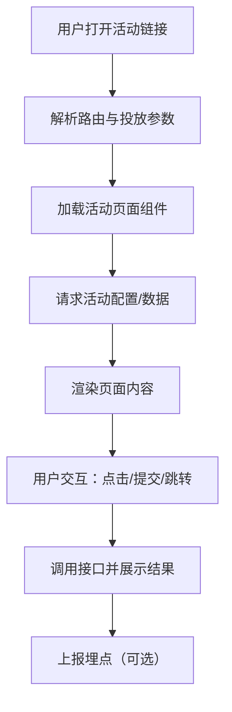

## 1. 产品概述
在 `h5/` 目录下新建一个独立的 Vue3 前端项目，用于承载广告落地页/运营活动页，并统一管理活动页面的路由、接口调用、埋点与部署产物。
- 目标用户：运营/投放同学（配置活动）、终端用户（访问活动页）
- 价值：活动页面独立迭代与发布，避免影响主后台 `web/` 与前台 `storefront/`

## 2. 核心功能

### 2.1 功能模块
1. **活动落地页容器（路由 + 页面壳）**：统一头部/底部（可配置隐藏）、SEO、分享信息、主题风格切换
2. **活动页面模板**：单页活动（表单收集/商品推荐/引导下载/跳转小程序等），可快速复制新页面
3. **接口调用封装**：统一 baseURL、超时、错误提示、鉴权/签名（若需要）、请求日志（可开关）
4. **运行环境配置**：开发/测试/正式的 API 地址、活动静态资源前缀等
5. **埋点能力（可选但建议内置）**：PV/按钮点击/表单提交/转化上报的统一封装

### 2.2 页面清单（必要页面）
| 页面名称 | 模块名称 | 功能描述 |
|---|---|---|
| 活动入口页（可选） | 活动列表 | 展示活动入口/灰度页（如果不需要可不启用路由） |
| 活动落地页 | 页面壳、模块区块 | 支持按路由加载不同活动组件，页面内调用接口拉取活动配置/商品数据 |
| 404 | 兜底页 | 路由不存在时展示 |

## 3. 核心流程
1. 用户访问活动链接（例如 `/campaign/summer-2026`）
2. 前端根据路由加载对应活动页面组件
3. 页面初始化：
   - 读取 query（投放参数，如 `utm_source`）
   - 拉取活动配置/商品数据（调用后端接口）
   - 触发 PV 埋点
4. 用户交互（点击/表单提交/领券等）：
   - 调用接口
   - 成功/失败提示
   - 触发埋点

## 4. 界面设计

### 4.1 设计风格
- 框架层：极简页面壳 + 内容区块化（每个活动页面自定义视觉）
- 主题：支持浅色/深色（默认浅色），活动可按需覆写 CSS 变量
- 字体：默认系统字体即可；如需更强品牌感，可在单个活动页面引入 webfont
- 动效：轻量（首屏淡入、按钮 hover/press、区块进入动画可选）

### 4.2 页面结构（默认模板）
| 页面名称 | 模块名称 | UI 元素 |
|---|---|---|
| 活动落地页 | Hero | 大标题/副标题/主按钮/活动主视觉 |
| 活动落地页 | 内容区块 | 图文区块、商品卡片、福利说明、FAQ |
| 活动落地页 | 转化区块 | 表单/领取按钮/跳转按钮（固定底栏可选） |

### 4.3 响应式
- 默认移动端优先（活动落地页更常见手机访问）
- 兼容桌面端（居中容器 + 最大宽度限制）
- 触控优化：按钮高度、间距、可点击区域符合移动端标准

